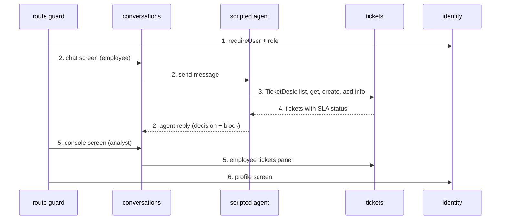
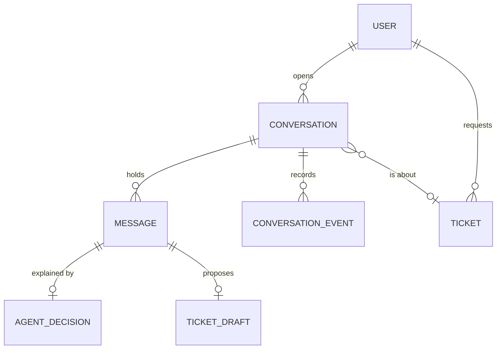
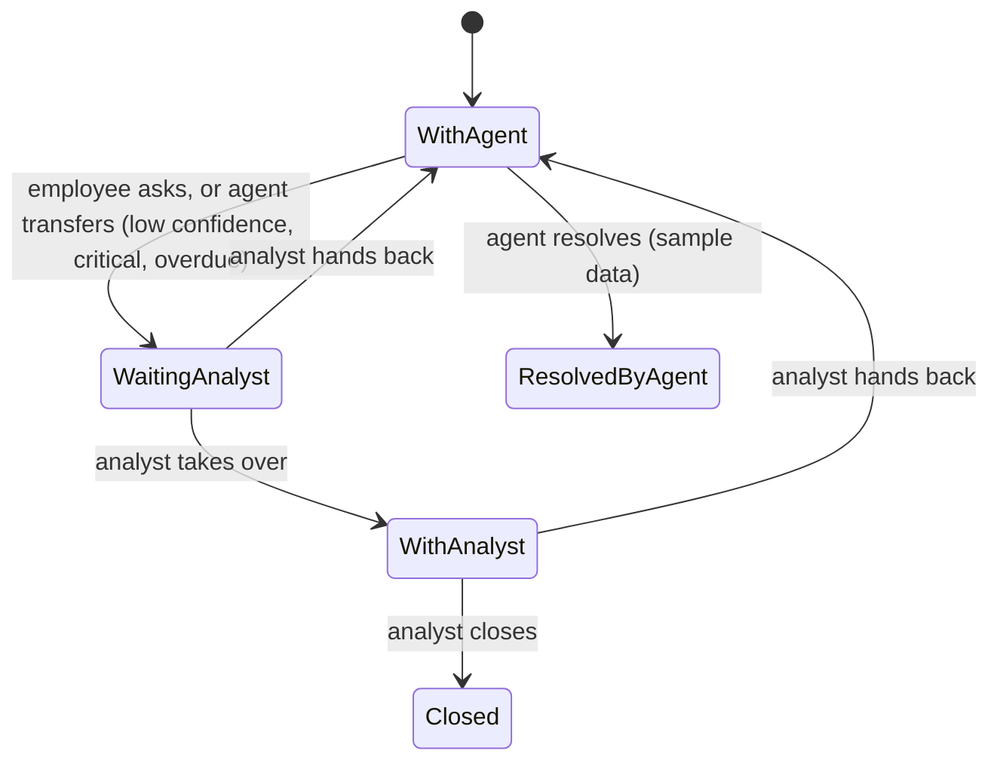
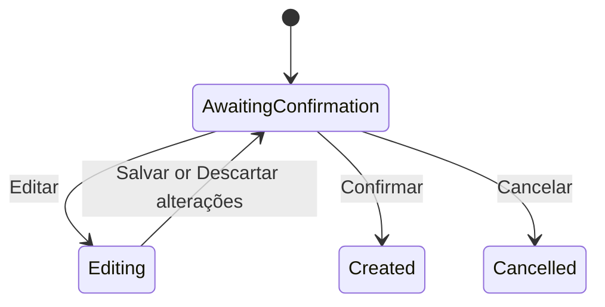

# Service desk screens with mocks

**Approved**: 2026-11-20 - user: "pode implementar direto, sem que eu aprove"

## Problem

After signing in, an employee lands on a placeholder ("O atendimento com o Nexo Assist chega na
próxima etapa") and an analyst lands on the same placeholder: none of the screens the prototype
draws after the login exist (employee chat, analyst console, profile). Nobody can try the flows
the PRD grades (open a ticket by talking, look up a ticket, hand over to an analyst, see why the
agent did what it did), and the agent and ticket service still to come have no screen and no
contract to plug into. The source gives no evidence beyond the PRD and the captures.

When this ships, an employee can open a ticket and look one up through the chat, ask for an
analyst and expand any agent reply to see what it understood, did, how sure it was and why; an
analyst can find, open, take over, hand back and close conversations next to the employee's
tickets; an employee can see their profile. Everything runs on in-browser mocks behind the ports
the real agent and ticket service will implement.

## Shape

Reuses the identity session (`findCurrentUser`, `requireUser`), the sign-out use case and the UI
framework, extending the framework instead of styling in screens. The rules that change an
outcome (SLA deadlines, overdue, conversation states and transitions, console filters, search and
ordering, the 30-message limit, confidence levels, option matching) run in the `domain` and
`application` layers of `tickets` and `conversations`, at 100% unit coverage; the scripted agent
and the sample data are infrastructure adapters, at 100% integration coverage.

1. employee opens `/` -> route guard (exists) - `requireUser`, role check; an analyst is sent to `/console`
2. `conversations` (new) chat screen - sends the employee's message through the chat port to the scripted agent adapter (door 3), which returns an agent reply (door 2)
3. scripted agent - reads and writes tickets through its `TicketDesk` port, which `main/` wires to `tickets` (door 1)
4. `tickets` (new) - in-memory ticket service with Annex B sample data; owns SLA deadline and overdue rules; ticket cards and the employee tickets panel
5. analyst opens `/console` -> `conversations` console screen - in-memory console adapter with sample conversations; take over, hand back, close, reply; the panel reads the employee's tickets from `tickets`
6. employee opens `/perfil` -> `identity` (exists) profile screen - name and e-mail from the session, password age from the credential; reset through a mocked port
7. out: rendered screens; nothing persists past a reload (AD-003)

**Changes underneath**

| Front       | What changes                                                                                                                                                                                                               |
| ----------- | -------------------------------------------------------------------------------------------------------------------------------------------------------------------------------------------------------------------------- |
| domain      | `/` meant the identity `WelcomeScreen` for every role; now it is the employee chat and redirects an analyst to `/console`. `WelcomeScreen` is removed; `e2e/login.spec.ts` asserts its heading and changes with that claim |
| stored data | nothing to migrate - conversations and tickets live in browser memory; identity tables are only read (the credential's `updatedAt`)                                                                                        |
| readers     | the login form's redirect to `/` now lands each role on its home; sign out moves to the employee sidebar and the analyst avatar menu                                                                                       |

New: Conversation, Message, AgentDecision, ConversationEvent, Ticket, TicketDraft - in browser
memory only, no table. One-way constraints: none (nothing persisted).

## Surface

| Route          | In             | Out             | Status                                                                         | Who      |
| -------------- | -------------- | --------------- | ------------------------------------------------------------------------------ | -------- |
| `GET /`        | session cookie | employee chat   | `200`; `307` to `/console` for an analyst; `307` to `/login` without a session | employee |
| `GET /perfil`  | session cookie | profile         | `200`; `307` to `/console` for an analyst; `307` to `/login` without a session | employee |
| `GET /console` | session cookie | analyst console | `200`; `307` to `/` for an employee; `307` to `/login` without a session       | analyst  |

## Landing

| One-way door                        | Literal shape                                                                                                                                                                                                                 | Alternative rejected                                                                                                                                                                                               |
| ----------------------------------- | ----------------------------------------------------------------------------------------------------------------------------------------------------------------------------------------------------------------------------- | ------------------------------------------------------------------------------------------------------------------------------------------------------------------------------------------------------------------ |
| 1. Cross-module dependency (AD-005) | `conversations/application/ports/ticket-desk.ts` declares what the agent needs; `main/client-providers.tsx` builds `makeTicketsClientModule()` and passes an adapter of it to `makeConversationsClientModule({ ticketDesk })` | `conversations/infrastructure` importing `@/modules/tickets/client` - the boundaries rule forbids it and the adapter would bind to the other module                                                                |
| 2. Agent reply contract (AD-006)    | `AgentReply = { decision: { understood, actions: [{ label, outcome }], confidence /* 0-1 */, reason }, parts: [{ kind: "text" \| "question" \| "ticket-picker" \| "ticket" \| "ticket-draft" \| "ticket-update", ... }] }`    | free text with the trace in markdown - it cannot render options, cards or a measurable confidence; one `text` plus one optional `block` - capture 3 shows a ticket card and a follow-up question in the same reply |
| 3. Mocks as adapters (AD-003)       | screens call ports in `application/ports`; `composition.client.ts` mounts `createScriptedAgent(...)` and `createInMemory...(...)` with sample data; the real agent replaces only those lines                                  | fixtures inside `presentation` - screens would bind to fixture shapes and all of it would be thrown away                                                                                                           |

- No new npm dependency.
- Nothing else in this change is hard to reverse.

## Criteria

### S1: An employee opens a ticket by talking (Screen 2) (P1)

The employee describes a problem, answers a quick question, reviews a draft and confirms it.

**Acceptance Criteria**

1. WHEN an employee signs in THEN the system SHALL show `/` with the sidebar ("Atendimento" active, "Meu perfil", the employee's initials, name and e-mail, "Sair"), the path "Service desk de TI > Atendimento" and the tag "Assistente online"
2. WHILE the conversation has no messages the system SHALL show a greeting with the employee's first name and the suggestions "Meu notebook não conecta na VPN. Erro 809." and "Qual o status do meu chamado?", and WHEN one is used THEN the system SHALL send its text as the employee's message
3. WHEN the employee sends a message THEN the system SHALL show it as a dark bubble on the right, clear the field, show "Nexo Assist está digitando…" until the reply arrives and raise the counter "N/30 mensagens nesta sessão" by 1
4. IF the field holds only blanks THEN the system SHALL keep "Enviar" disabled
5. WHEN the first message mentions VPN or error 809 THEN the system SHALL reply with the actions "consultou seus chamados" and "buscou na central de ajuda", the text "Não há chamado aberto sobre VPN, e o artigo do erro 809 vale só para Windows 10 — o seu é Windows 11. Vou abrir um chamado." and the question "Quem está sendo afetado?" with the options "Só eu", "Minha equipe", "Toda a empresa" and "Não sei"
6. WHEN the employee uses a quick option THEN the system SHALL send its label as the employee's message, mark that option as chosen and disable the question's other options
7. IF the employee types an answer to an open question THEN the system SHALL treat it as the option whose label starts the text, ignoring case and accents, and as "Não sei" otherwise
   - "Só eu. Tenho reunião às 14h" → "Só eu"; "so eu" → "Só eu"; "minha equipe toda" → "Minha equipe"; "o andar inteiro" → "Não sei"; "acho que toda a empresa" → "Não sei" (a label inside the text does not start it)
8. WHEN the employee answers who is affected THEN the system SHALL reply with the actions "classificou a prioridade", "consultou o SLA" and "montou o rascunho" and the draft card "Novo chamado · Rascunho D-NNN" with "Aguardando confirmação", title, description, Categoria "Rede e VPN", Prioridade with "resposta até HH:MM", Afetados, and the buttons "Confirmar" (with its shortcut), "Editar" and "Cancelar", shown in `.specs/features/service-desk-screens/captures/chat-new-ticket.png`
9. The scripted agent SHALL set the draft's priority and affected people from the answer
   - "Só eu" → Alta, "Somente você"; "Não sei" → Alta, "Não informado"; "Minha equipe" → Crítica, "Sua equipe"; "Toda a empresa" → Crítica, "Toda a empresa"
10. The tickets domain SHALL compute a response deadline from the priority and a start time, with business time Monday to Friday 08:00-18:00 in America/Sao_Paulo (UTC-3), Crítica 1 wall-clock hour, Alta 4 business hours, Média 3 business days and Baixa 5 business days (a business day is 10 business hours)
    - Alta from Mon 09:43 → Mon 13:43; Alta from Fri 16:00 → Mon 10:00; Alta from Tue 19:00 → Wed 12:00; Crítica from Sat 23:30 → Sun 00:30; Média from Thu 14:20 → Tue 14:20; Baixa from Mon 08:00 → Fri 18:00
11. WHEN the employee uses "Confirmar", or presses Ctrl+Enter (⌘+Enter on a Mac) while a draft awaits confirmation, THEN the system SHALL create an INC ticket in the simulated ticket service, show the card as created with its code "INC-NNNNN" and status "Aguardando analista", remove its buttons, and reply with the action "criou o chamado" and "Pronto: abri o chamado INC-NNNNN com prioridade alta. Um analista fala com você em até 4 h úteis."
12. WHEN the employee uses "Editar" THEN the system SHALL turn the title and the description into fields with "Salvar" and "Descartar alterações"; "Salvar" SHALL keep the edited text and return the draft to "Aguardando confirmação"; "Descartar alterações" SHALL restore the previous text
13. IF the edited title is blank THEN the system SHALL show "Informe um título." under it and keep the draft in edition
14. WHEN the employee uses "Cancelar" on a draft THEN the system SHALL show the draft as "Cancelado" without buttons, create no ticket, and reply "Tudo bem, não abri o chamado. Se precisar, é só me chamar."
15. IF the first message matches no script THEN the system SHALL reply "Esta é uma demonstração com respostas roteirizadas. Experimente uma destas conversas:" with the two suggestions of criterion 2 as quick options

### S2: An employee looks a ticket up and asks for an analyst (Screen 3) (P1)

**Acceptance Criteria**

16. WHEN the first message asks for a ticket's status ("status", "andamento" or "meu chamado") THEN the system SHALL reply with the action "consultou seus chamados", "Você tem N chamados abertos. Sobre qual deles quer saber?" and a list to pick from with each open ticket's code, title, status and opening date
17. The system SHALL list only the tickets of the employee who asks
    - Ana asks → her 3 open tickets; Bruno asks → none of Ana's tickets; Bruno with no open ticket → "Você não tem chamados abertos agora."
18. WHEN the employee picks a ticket THEN the system SHALL mark its row, lock the list, send "<code> · <title>" as the employee's message and reply with the actions "consultou o <code>" and "calculou o prazo" and the ticket card (Categoria, Prioridade, Aberto em, Última atualização), shown in `.specs/features/service-desk-screens/captures/chat-status-transfer.png`
19. The tickets domain SHALL call a ticket overdue when it is not resolved and its last update (or its opening, with no update) plus its priority deadline is before now
    - Média updated Wed 10:00, now Mon 10:00 → not overdue; now Mon 10:01 → overdue; resolved and updated 30 days ago → not overdue
20. IF the picked ticket is overdue THEN the card SHALL show the last update in warning tone with "· prazo vencido" and the agent SHALL ask "Está sem atualização há N dias, acima do prazo de <deadline> para prioridade <priority>. Quer que eu chame um analista?" with the options "Falar com um analista", "Adicionar informação" and "Não, obrigado"; otherwise the card SHALL show "· no prazo" and the agent SHALL offer only "Adicionar informação" and "Não, obrigado"
21. WHEN the employee uses "Falar com um analista" THEN the system SHALL reply with the action "transferiu para um analista" and "Encaminhei para o Suporte N2. Um analista vai falar com você em até 2 h úteis.", show the event "Transferida para Suporte N2 · HH:MM" and change the top tag to "Aguardando atendente"
22. WHILE the conversation waits for an analyst the system SHALL show the employee's new messages and count them, SHALL NOT produce agent replies, and SHALL show "Um analista vai continuar este atendimento. Suas mensagens chegam para ele." above the field
23. WHEN the employee uses "Adicionar informação" THEN the agent SHALL ask "O que você quer acrescentar ao <code>?", and on the next message SHALL show the update draft "Atualizar chamado · <code>" with that text and "Confirmar" and "Cancelar"; "Confirmar" SHALL add the text to the ticket in the simulated service and reply "Pronto: acrescentei a informação ao <code>."
24. WHEN the employee uses "Não, obrigado" THEN the agent SHALL reply "Combinado. Se precisar de algo, é só escrever."

### S3: Anyone can see why the agent did what it did (P1)

**Acceptance Criteria**

25. WHEN the employee uses the actions row above an agent reply THEN the system SHALL expand under it "O que entendi", each action with its outcome, "Confiança" as a percentage with its level, and "Por quê", and set `aria-expanded` to true; using it again SHALL collapse it
26. The conversations domain SHALL name the confidence level from the rounded percentage shown beside it
    - 0.80 → "alta"; 0.79 → "média"; 0.50 → "média"; 0.49 → "baixa"; 0.41 → "baixa"; 0.795 → "80% · alta"; 0.495 → "50% · média"
27. WHEN the analyst uses the "Nexo Assist IA" label of an agent message in the console THEN the system SHALL expand the same detail under that message

### S4: An analyst sees the conversations that need them (Screen 4) (P1)

**Acceptance Criteria**

28. WHEN an analyst signs in THEN the system SHALL show `/console` with the conversation list (filter "Todas" selected), the first conversation open and the employee's tickets panel, shown in `.specs/features/service-desk-screens/captures/console-transferred.png`
29. The conversations domain SHALL order the list by group - waiting for an analyst or with an analyst, then with the agent, then resolved or closed - and by most recent activity inside a group
    - transferred 10:05 before with-agent "agora"; resolved yesterday after with-agent 10:01
30. WHEN the analyst uses a filter THEN the system SHALL list only its conversations: "Para você" waiting for an analyst (any reason), "Com o agent" with the agent, "Minhas" with the signed-in analyst, "Todas" every one; every filter but "Todas" SHALL show its count
31. WHEN the analyst types in "Pesquisar conversa ou chamado" THEN the system SHALL list, inside the active filter, only conversations whose employee name or ticket code contains the text, ignoring case and accents
    - "inc-20311" → Ana Souza; "fabio" → Fábio Nunes; "souza" → Ana Souza; "20311" → Ana Souza; "xyz" → "Nenhuma conversa encontrada para “xyz”."
32. The list item SHALL show the avatar with initials and presence, the name, the last activity time ("agora", "HH:MM", "ontem" or "DD mmm", in primary tone when unread), the last message preview ("Nexo: " with a double check when it came from the agent, "digitando…" while the employee types), the unread count, and the status line: "Transferida · <code>" or "Transferida · contato em N min" (danger), "Agent pediu ajuda · confiança N%" (warning), "Agent atendendo" (success), "Você está atendendo" (primary), "Com <analyst>" (primary), "Resolvida pelo agent" or "Encerrada" (muted)
33. WHEN the analyst uses a conversation in the list THEN the system SHALL open it: header (avatar, name, "online · <department>" plus the ticket code while it waits, state tag), history with a date divider, employee bubbles on the left, agent ("Nexo Assist IA") and analyst (name and "Suporte N2") bubbles on the right with time and double check, centered transfer and take-over events, and the panel with that employee's tickets
34. WHILE the open conversation waits for an analyst the footer SHALL show "<first name> espera um atendente", "Agent pausado · até HH:MM", "Devolver ao agent", "Assumir atendimento" and the disabled field "Assuma o atendimento para responder"
35. The tickets panel SHALL show "Chamados de <first name>" (AD-007) with "N abertos · M encerrados", "Desta conversa" with the conversation's ticket and its last conversation event, and "Outros chamados" with open tickets first and then closed ones, newest first; WHEN the analyst uses a ticket under "Outros chamados" THEN the system SHALL expand its description, priority and deadline status in place
36. IF the employee has no ticket THEN the panel SHALL show "<first name> não tem chamados."; IF the conversation has no ticket THEN "Desta conversa" SHALL NOT appear
37. WHEN the analyst uses the panel's close button THEN the system SHALL hide the panel, and "Mostrar chamados de <first name>" in the ⋮ menu SHALL show it again
38. WHEN the analyst uses the search button in the conversation header THEN the system SHALL show "Buscar na conversa", list only the messages that contain the text (ignoring case and accents) with "N mensagens", and Escape or its close button SHALL restore the full history

### S5: An analyst takes over, replies, hands back and closes (Screen 5) (P1)

**Acceptance Criteria**

39. WHEN the analyst uses "Assumir atendimento" THEN the system SHALL add the event "<analyst> assumiu · agent pausado · HH:MM", show "Devolver ao agent" and "Encerrar atendimento" in the header, enable the field with its send button, show "Você está atendendo" with no unread count on the list item, show the panel ticket as "Em atendimento" with "Assumido por <analyst> HH:MM", and move the conversation from "Para você" to "Minhas", shown in `.specs/features/service-desk-screens/captures/console-assumed.png`
40. WHEN the analyst sends a message THEN the system SHALL show it as a green bubble with the analyst's name, "Suporte N2", time and double check, and clear the field; Enter SHALL send and a blank message SHALL NOT be sent
41. WHEN the analyst sends the first message in a sample conversation with a scripted employee answer THEN the system SHALL show that answer about 2 seconds later
    - Ana Souza answers "Posso sim, está ligado."
42. WHEN the analyst uses "Devolver ao agent" THEN the system SHALL add the event "<analyst> devolveu ao agent · HH:MM" (or "Devolvida ao agent · HH:MM" when nobody had taken over), set the status to "Agent atendendo" and show in the footer "Nexo Assist está atendendo esta conversa." with "Assumir atendimento" and the field disabled
43. WHEN the analyst uses "Encerrar atendimento" THEN the system SHALL ask "Encerrar o atendimento de <name>?" with "Cancelar" and "Encerrar"; "Cancelar" SHALL change nothing; "Encerrar" SHALL add the event "<analyst> encerrou o atendimento · HH:MM", set the status to "Encerrada" and show "Atendimento encerrado." in the footer with the field disabled
44. WHILE the open conversation is resolved or closed the footer SHALL show "Atendimento encerrado." with no action
45. The console rail SHALL show the brand mark, "Conversas" with the number of conversations waiting for an analyst, and the analyst's initials; WHEN the analyst uses the initials THEN the system SHALL show their name, e-mail and "Sair", and "Sair" SHALL sign out to `/login`

### S6: An employee sees their profile (P2)

**Acceptance Criteria**

46. WHEN the employee uses "Meu perfil" THEN the system SHALL show `/perfil` with "Meu perfil", "Seus dados de acesso ao service desk de TI.", Nome, E-mail corporativo with "Gerenciado pela TI", and the password card "Senha" with its age, "Redefinir senha" and "Enviaremos um link de redefinição para <e-mail>.", shown in `.specs/features/service-desk-screens/captures/profile.png`
47. The password age SHALL come from the credential's last update
    - updated today → "Alterada hoje"; 1 day ago → "Alterada há 1 dia"; 42 days ago → "Alterada há 42 dias"
48. WHEN the employee uses "Redefinir senha" THEN the button SHALL show its loading state and, when the mocked request succeeds, the footer SHALL read "Enviamos um link de redefinição para <e-mail>." and the button "Reenviar link"
49. IF the reset request fails THEN the system SHALL show "Não foi possível enviar o link agora. Tente de novo em instantes." and enable the button again

### S7: Roles, limits and states (P1)

**Acceptance Criteria**

50. WHEN an analyst opens `/` or `/perfil` THEN the system SHALL redirect to `/console`; WHEN an employee opens `/console` THEN the system SHALL redirect to `/`
51. WHEN the employee sends the 30th message of the session THEN the system SHALL disable the field and the quick options and show "Você chegou ao limite de 30 mensagens nesta sessão."
    - 29 sent → field enabled, "29/30 mensagens nesta sessão"; 30 sent → field disabled, "30/30 mensagens nesta sessão"
52. IF sending an employee message fails THEN its bubble SHALL show "Não foi possível enviar." with "Tentar de novo", the counter SHALL NOT count it, and "Tentar de novo" SHALL resend it without a second bubble
53. IF a console action (take over, hand back, close, send) fails THEN the system SHALL show "Não foi possível <action> agora. Tente de novo." and keep the conversation as it was
54. WHILE the conversation, the conversation list or the tickets panel loads the system SHALL show a loading state labeled "Carregando sua conversa…", "Carregando conversas…" or "Carregando chamados…"
55. IF the active filter has no conversation THEN the list SHALL show "Nenhuma conversa aqui."; IF no conversation is open THEN the conversation area SHALL show "Selecione uma conversa para ver o histórico."
56. WHEN the page reloads THEN the system SHALL start again from the sample data (AD-003)

## Out of scope

| Excluded                                                                | Why                                                             |
| ----------------------------------------------------------------------- | --------------------------------------------------------------- |
| The real agent (Mastra, LLM) and free interpretation of messages        | next feature; the mock follows fixed scripts (AD-003)           |
| Persisting conversations and tickets in PostgreSQL, surviving a restart | next feature; mocks reset on reload (AD-003)                    |
| Live link between the employee chat and the analyst console             | mock worlds are separate (AD-003)                               |
| Narrow and mobile layouts                                               | the captures are desktop only (1440 and 1567 px wide)           |
| Sending a real password reset e-mail                                    | no e-mail service; the request is mocked                        |
| "Ver todos os chamados" and switching "Disponível"                      | visual only (AD-004)                                            |
| Legacy ticket system downtime and retries                               | belongs to the real ticket service and the agent                |
| The login (Screen 1)                                                    | delivered; this feature does not change it                      |
| An analyst profile page                                                 | no capture draws it; the analyst signs out from the avatar menu |

## Assumptions

| Assumption                              | Chosen default                                                                                                                   | Rationale                                                 | Confirmed? |
| --------------------------------------- | -------------------------------------------------------------------------------------------------------------------------------- | --------------------------------------------------------- | ---------- |
| How far the mocks go                    | ports with in-memory adapters in the browser, separate employee and analyst worlds                                               | user chose "Portas + mock no navegador (Recomendado)"     | y          |
| Format of the decision detail           | expands inline under the actions row, in chat and console                                                                        | user chose "Expandir na mensagem (Recomendado)"           | y          |
| Console default filter                  | "Todas"                                                                                                                          | user chose "'Todas' por padrão (Recomendado)"             | y          |
| Controls with no defined behaviour      | simple mock behaviour; "Ver todos" and "Disponível" visual only                                                                  | user chose "Comportamento mock simples (Recomendado)"     | y          |
| Routes                                  | `/` chat (employee), `/perfil`, `/console` (analyst); each role redirected to its home                                           | pt-BR URLs like the UI; the login already sends to `/`    | n          |
| Captures in git                         | `captures/` is git-ignored whole: the prototype captures and the `*.running.png` pictures stay local                             | user: "pode colocar no git ignore ele tbm"                | y          |
| Mock scripts                            | first message with "status", "andamento" or "meu chamado" → lookup; with "vpn" or "809" → new ticket; anything else → demo reply | reach every screen by gesture without an LLM              | n          |
| Business calendar                       | Mon-Fri 08:00-18:00 America/Sao_Paulo (fixed UTC-3), no holidays; Crítica counts wall-clock hours                                | Annex B service desk hours; critical has a 24 h on-call   | n          |
| Message counter                         | counts the employee's messages sent successfully, quick options included; a session is a page load                               | the PRD does not define a session; mocks reset on reload  | n          |
| Confirm shortcut                        | Ctrl+Enter (⌘+Enter on a Mac) while a draft awaits; the key reads "⌘↵" on a Mac and "Ctrl ↵" elsewhere                           | the capture shows "⌘↵"                                    | n          |
| Draft edition                           | title and description only                                                                                                       | category and priority are the agent's classification      | n          |
| Unread count                            | cleared when an analyst takes over                                                                                               | capture 4 shows the open conversation still with 2 unread | n          |
| Header subtitle                         | the ticket code appears only while waiting                                                                                       | captures 4 and 5 differ that way                          | n          |
| Scripted employee answer in the console | some sample conversations answer 2 s after the analyst's first message                                                           | reach Screen 5 by gesture                                 | n          |
| "Outros chamados" rows                  | expand in place                                                                                                                  | the chevron asks for a gesture                            | n          |
| Closing                                 | asks for confirmation in a dialog                                                                                                | it takes the conversation out of the queue                | n          |
| ⋮ menu                                  | "Ocultar/Mostrar chamados de <first name>" and "Encerrar atendimento" while the analyst attends                                  | the panel's close button needs a way back                 | n          |
| Analyst team                            | "Suporte N2" for every seeded analyst                                                                                            | identity has no team; the captures show Suporte N2        | n          |
| Password age                            | the credential's `updatedAt`                                                                                                     | real data; "42 dias" is sample data                       | n          |
| Empty chat                              | greeting with first name and two suggestions                                                                                     | no capture draws an empty conversation                    | n          |
| Rail badge                              | number of conversations waiting for an analyst                                                                                   | the capture's 5 is sample data                            | n          |
| Sample data                             | names, times, codes and counts recreated relative to now; employees not in the seed exist only in the console mock               | sample data is not transcribed                            | n          |

**Open questions:** none - all resolved or logged above.

## Differences from the source

| Source shows                                                           | Product shows                                                                                  | Confirmed  |
| ---------------------------------------------------------------------- | ---------------------------------------------------------------------------------------------- | ---------- |
| Filter "Para você" highlighted on open (capture 4)                     | "Todas" highlighted on open; "Para você" when used                                             | y - AD-001 |
| Actions row above an agent reply with no affordance (captures 2 and 3) | the actions row is a button with a chevron that expands the decision detail                    | y - AD-002 |
| "Nexo Assist IA" label with no affordance (captures 4 and 5)           | the label is a button with a chevron that expands the decision detail                          | y - AD-002 |
| "Ver todos os chamados da Ana ↗" as an action (captures 4 and 5)       | the same button, inert (`aria-disabled`), with the hint "Disponível com o sistema de chamados" | y - AD-004 |
| "Chamados da Ana", "Ver todos os chamados da Ana" (captures 4 and 5)   | "Chamados de Ana", "Ver todos os chamados de Ana"                                              | y - AD-007 |

## Sources

- `design/Desafio_Tecnico_Nexo_Assist_PRD_v5.md` - binding - rules (Annex A), sample data (Annex B), screens (Annex C)
- Pencil prototype https://app.pen.dev/s/swhm7Xfy1krKDIc-QyqE9J8ZI2xFB0qbNvHIncCXcLg, exported to `design/` on 2026-11-20 - binding
-  - binding - Screen 2: quick question and ticket draft
-  - binding - Screen 3: ticket picker, overdue ticket, offer of an analyst
-  - binding - Screen 4: list, transferred conversation, employee tickets
-  - binding - Screen 5: analyst attending
-  - binding - employee profile
- `design/Identificação (desktop).png` - binding - Screen 1, unchanged by this feature
